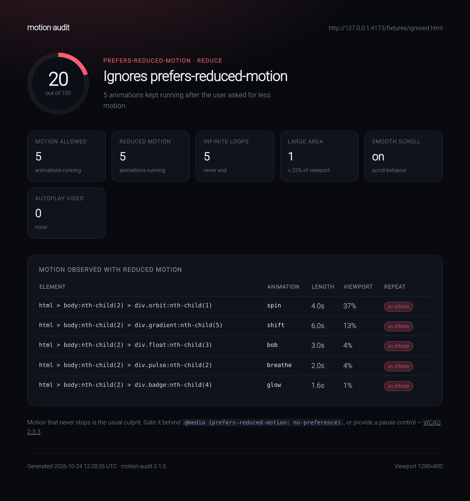

# motion-audit

**Find out whether a page respects `prefers-reduced-motion`, and exactly what keeps moving if it doesn't.**

[](LICENSE)
[](https://nodejs.org)



One command, two passes of the same page - once with motion allowed, once with the user's preference applied - then a score, a verdict, and the elements that ignore it.

```console
$ npx github:bilalmlkdev/motion-audit http://localhost:4173/fixtures/ignored.html

  motion-audit 0.1.0
  http://localhost:4173/fixtures/ignored.html
  Ignored - animates regardless of preference

  ✖ ignores prefers-reduced-motion  20/100

  motion allowed      5 running
  reduced motion      5 running
  infinite loops      5
  large-area motion   1
  smooth scrolling    on
  marquee elements    1

  motion observed with reduced motion
  ────────────────────────────────────────────────────────────────────────
  html > body:nth-child(2) > div.orbit:nth-… infinite 4.0s   37% viewport
  html > body:nth-child(2) > div.gradient:n… infinite 6.0s   13% viewport
  html > body:nth-child(2) > div.float:nth-… infinite 3.0s   4% viewport
  html > body:nth-child(2) > div.pulse:nth-… infinite 2.0s   4% viewport
  html > body:nth-child(2) > div.badge:nth-… infinite 1.6s   1% viewport

  Fix: wrap continuous animation in @media (prefers-reduced-motion: no-preference)
  or give the user a pause control (WCAG 2.2.2 / 2.3.3).
```

## Why this exists

Most accessibility checks stop at contrast, labels and alt text. Motion gets skipped because it is hard to measure: a stylesheet can declare a media query and still ignore it in JavaScript, and a single snapshot of "is it animating right now?" misses one-shot reveals entirely.

`motion-audit` loads the page twice in a real Chromium browser and records **what actually moved** in each mode, including CSS animations, transitions, Web Animations, smooth scrolling, autoplaying video and `<marquee>`. If motion happens with `prefers-reduced-motion: reduce` active, it lands in the report.

That matters because motion is covered by [WCAG 2.3.3](https://www.w3.org/WAI/WCAG22/Understanding/animation-from-interactions.html) and [2.2.2](https://www.w3.org/WAI/WCAG22/Understanding/pause-stop-hide.html), and the European Accessibility Act has applied to consumer-facing services since June 2025.

## Quick start

```bash
npx github:bilalmlkdev/motion-audit https://example.com
```

That is the whole install. npx caches the checkout, and the audit drives a Chromium browser you already have - Chrome, Chromium, Edge or Brave - so there is no 150 MB download. Set `CHROME_PATH` or pass `--chrome <path>` if auto-detection misses it.

Once the package is published to npm, `npx motion-audit <url>` does the same thing with less typing.

## What it checks

| Check | What counts |
| --- | --- |
| **Motion under reduce** | CSS animations, transitions and Web Animations that ran while `prefers-reduced-motion: reduce` was active |
| **Infinite loops** | Animations with `animation-iteration-count: infinite` still looping under reduce |
| **Large-area motion** | Infinite animation on an element covering at least 25% of the viewport |
| **Smooth scrolling** | `scroll-behavior: smooth` still active under reduce |
| **Autoplay video** | Playing `<video autoplay>`, with unmuted ones weighted higher |
| **Marquee** | The `<marquee>` element, still moving after all these years |

Only motion that actually happens is scored. A `@media (prefers-reduced-motion: reduce)` block that disables everything produces a clean report even if the CSS looks scary.

## Verdicts and score

| Verdict | Meaning |
| --- | --- |
| `none` | Nothing animated in either pass |
| `respected` | Nothing ran once the preference was applied |
| `partial` | Some motion stopped; some still ran |
| `ignored` | At least 75% of the motion kept running under reduce |

The score starts at 100 and subtracts for the verdict, infinite loops, large-area motion, smooth scrolling, unmuted autoplay and marquees. It is a heuristic for triage, not a compliance certificate.

## HTML report

```bash
npx github:bilalmlkdev/motion-audit https://example.com --html report.html
```

A standalone file with the score, the counts and every offending element. No scripts, no external assets, safe to attach to a ticket. That is what the screenshot at the top shows.

## In CI

```bash
npx github:bilalmlkdev/motion-audit "$PREVIEW_URL" --fail-on ignored --quiet
```

Swap the GitHub spec for `motion-audit` once the package is on npm.

Exit codes: `0` clean or within threshold, `1` the verdict met `--fail-on`, `2` usage error or the page could not be audited. `--quiet` prints one tab-separated line.

A ready-made workflow is in [`examples/github-actions.yml`](examples/github-actions.yml). GitHub's `ubuntu-latest` runners ship Google Chrome, which is all this needs.

## Options

```
--json                print the raw result as JSON
--html <file>         write a standalone HTML report
--settle <ms>         wait after load before observing (default 400)
--window <ms>         how long to watch for motion (default 1500)
--timeout <ms>        navigation timeout (default 30000)
--no-scroll           skip scrolling (faster, misses scroll-triggered motion)
--fail-on <level>     exit 1 on this verdict or worse: partial | ignored
--chrome <path>       browser binary to drive (default: auto-detect)
--quiet               one line of output, good for scripts
```

`--json` returns the full result, including every offender with its selector, duration, iteration count and viewport share.

## How it works

1. Launches your browser headless at 1280×800.
2. Pass 1: emulates `prefers-reduced-motion: no-preference`, loads the page, scrolls through it in fixed steps, then records running animations and listens for `animationstart` / `transitionrun` events for the observation window.
3. Pass 2: repeats the same sequence with `reduce` active.
4. Diffs the two passes and ranks what survived.

Listening for events rather than taking a single reading is what catches one-shot transitions; the two passes make the comparison fair.

## Limitations

- **Canvas and WebGL are not measured.** The audit reads DOM/CSS animation, and WebGL is disabled during the run so software rendering cannot stall the page. A canvas-only animation will not appear.
- **Hover, focus and click states are not triggered.** Motion that only happens on interaction is out of scope.
- Iframes are not audited separately.
- The viewport is fixed at 1280×800; responsive variants can behave differently.
- Smooth scrolling and autoplay video count against the page even when they are arguably intentional.
- The score is a triage heuristic, not a WCAG conformance result.

## Development

```bash
npm install
npm test
```

The fixtures cover the four verdicts plus a scroll-triggered reveal: `ignored.html`, `partial.html`, `respected.html`, `static.html`, `scroll-triggered.html`. To try the report by hand:

```bash
python3 -m http.server 4173
node bin/motion-audit.js http://localhost:4173/fixtures/ignored.html --html report.html
```

## License

[MIT](LICENSE)
